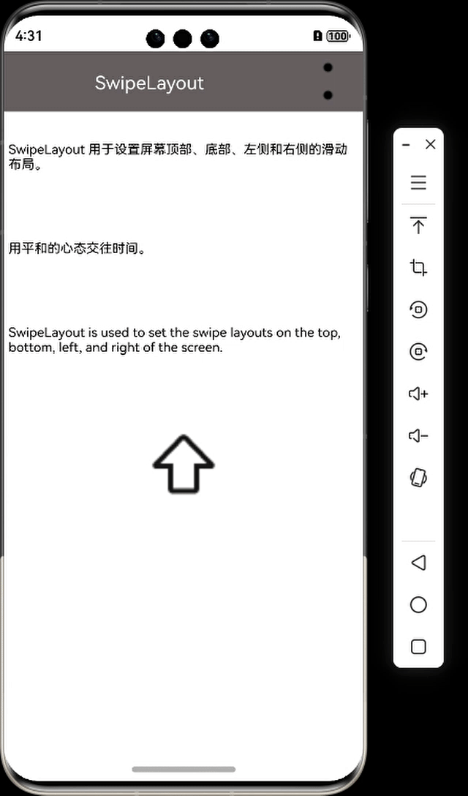
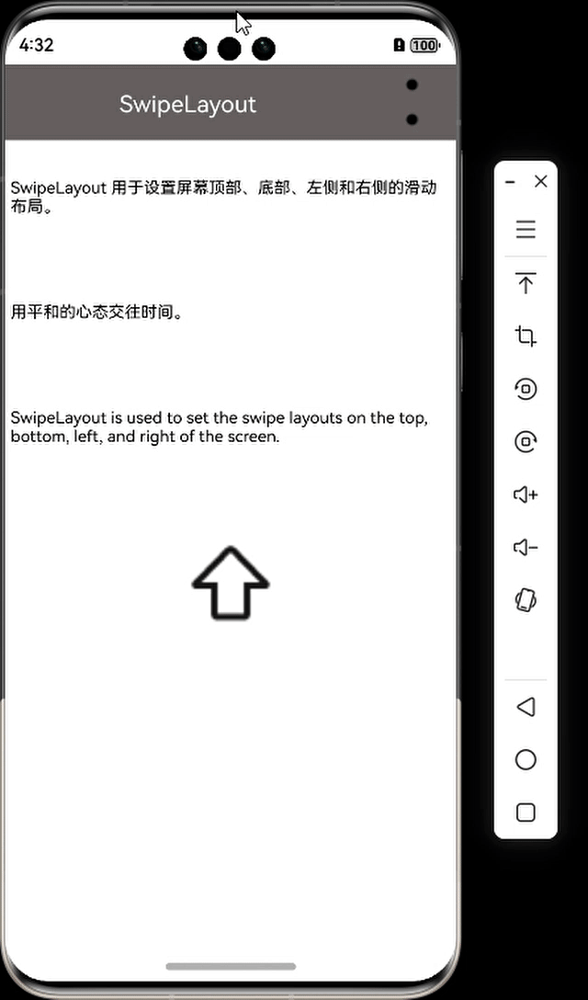
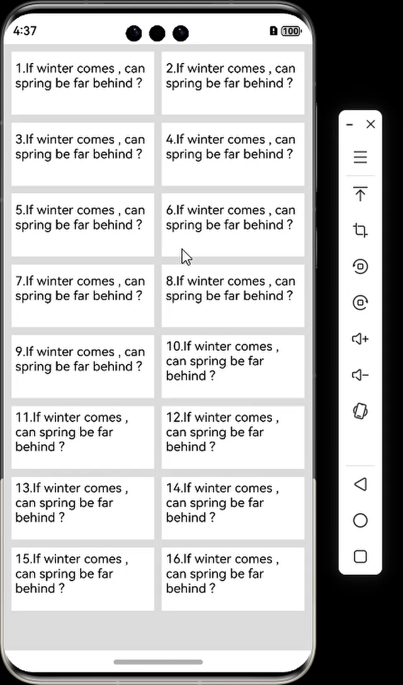

<div align="center">
<h1>swipe-layout-cj</h1>
</div>

<p align="center">


</p>

## 介绍 

swipe-layout-cj 用于设置屏幕顶部、底部、左侧和右侧的滑动布局。

<p align="left">

</p>

## 特性

- SwipeLayout 支持设置屏幕顶部、底部、左侧和右侧的滑动布局；
- SwipeLayoutLayDownFullList 支持设置右侧的滑动布局；
- CustomContainerUserGrid 支持设置右侧的滑动布局；
- SwipeLayoutLayDownRoot 支持设置嵌套滑动容器；

### 源码目录

```shell
├─AppScope
├─doc            # API文档和使用手册存放目录                   
├─entry          # 示例代码文件夹                  
├─swipelayout    # swipelayout 库源目录                  
│  └─src
│      └─main
│          ├─cangjie
│          │  └─src                                     
│          │      ├─swipe_layout.cj                   # 自定义滑动容器
│          │      ├─swipe_layout_lay_down.cj          # 嵌套式滑动容器子容器
│          │      ├─swipe_layout_lay_down_full        # 嵌套式滑动容器子容器
│          │      ├─swipe_layout_lay_down_full_grid   # 适用于 Grid 组件的自定义滑动容器
│          │      ├─swipe_layout_lay_down_full_list   # 适用于 List 组件的自定义滑动容器
│          │      ├─swipe_layout_lay_down_root        # 嵌套式滑动容器
│          │      ├─swipe_layout_lay_out              # 嵌套式滑动容器子容器
│          └─resources
├─hvigor     # 构建工具目录
├─README.md  # swipe-layout-cj 介绍及使用说明
```
## 接口说明

主要类和函数接口说明详见 [API](doc/feature_api.md)

## 使用说明

1. 通过 module 引入
    1. 克隆下载项目
    2. 将 swipelayout 模块拷贝到应用项目下
    3. entry 下的 cjpm.toml 文件, 在此文件中添加swipelayout依赖，如下：
      ```toml
      [dependencies]
         [dependencies.swipelayout]  
           path = "../swipelayout"
      ```
   4. 在项目中使用 import swipelayout.* 引用 swipelayout 项目
       ```cangjie
       import swipelayout.*
       ```
2. 把 swipe-layout-cj 作为三方库依赖引入
    1. 目标工程把 swipe-layout-cj 依赖库作为 git submodule 引入

    ```
    > cd $工程根目录
    > mkdir third-party
    > cd third-party
    > git submodule add "https://gitcode.com/Cangjie-TPC/swipe-layout-cj.git"
    ```
    2. 修改自身应用 entry/src/main/cangjie 下的 cjpm.toml 文件，添加依赖
    ```toml
    [dependencies]
         [dependencies.swipelayout]  
           path = "../swipelayout"
     ```
    3. 在项目中使用 swipelayout 组件
       ```cangjie
       import swipelayout.*
       ```

## 功能示例

详见 `entry`

#### List 滑动容器示例

```cangjie
internal import cj_res_entry.app
import ohos.display.*
import swipelayout.SwipeLayoutLayDownFullList
import ohos.base.*
import ohos.component.*
import ohos.state_manage.*
import ohos.state_macro_manage.*
import ohos.prompt_action.*

@Entry
@Component
public class CustomContainerUserList {
    private var arr: Array<Int64> = [1, 2, 3, 4, 5, 6, 7, 8, 9, 10, 11, 12, 13, 14, 15, 16, 17, 18, 19, 20, 21, 22, 23,
    24, 25, 26]
    private var text: String = ".Do not, for one repulse, forgo the purpose that you resolved to effort."

    private var disWidth: Int32 = 0

    protected override func aboutToAppear() {
        this.disWidth = getDefaultDisplaySync().width
    }
    @Builder   // list 列表组件
    func surfaceView(itemContent: String, itemId: Int64) {
            Text("${itemContent + this.text}").fontSize(16).width(100.percent).height(90).fontColor(Color.BLACK).padding(
                5).backgroundColor(Color.WHITE)
    }
    @Builder
    func bottomViewRight(itemId: Int64) {   // 设置右侧滑动布局样式
        Image(@r(app.media.trash)).backgroundColor(0xff64e3b9).width(10.percent).height(100.percent).padding(10).objectFit(
            ImageFit.Contain).onClick({
            evt => PromptAction.showToast(
                message: "Magnifier",
                duration: 1500,
            )
        })
        Text("Delete item?").fontSize(14).height(100.percent).fontColor(Color.WHITE).padding(5).onClick(
            {
            evt => PromptAction.showToast(
                message: "Click on surface",
                duration: 1500,
            )
        })

        Blank()

        Button("Yes,Delete").backgroundColor(Color.WHITE).fontColor(0xe52626).fontSize(14).width(35.percent).height(
            70.px).shape(ShapeType.Capsule).margin(right: 10.0).onClick(
            {
            event => PromptAction.showToast(message: "click delete", duration: 1500)
        })
    }
    func build() {
        Column() {
            List(initialIndex: 0) {
                ForEach(
                    this.arr,
                    itemGeneratorFunc: {
                        item: Int64, index: Int64 => ListItem() {
                            SwipeLayoutLayDownFullList(
                                bottomViewRightW: Float64(this.disWidth),
                                surfaceView: surfaceView,  // list 列表组件
                                bottomViewRight: bottomViewRight, // 右侧滑动布局样式
                                mWidth: 100.0, // 组件宽度
                                mHeight: 90.0, // 组件高度
                                itemContent: item.toString(), // list 内容
                                itemId: index // list 索引
                            )
                        }
                    }
                )
            }.divider(strokeWidth: 5.px, color: Color(0xd2d3cc)).width(100.percent)
        }.width(100.percent).height(100.percent).backgroundColor(0xDCDCDC).padding(top: 5)
    }
}
```
<p align="left">

</p>

#### Grid 滑动容器示例

```cangjie

package ohos_app_cangjie_entry.pages

internal import cj_res_entry.app
import swipelayout.SwipeLayoutLayDownFullGrid
import ohos.base.*
import ohos.component.*
import ohos.state_manage.*
import ohos.state_macro_manage.*
import ohos.prompt_action.*

@Entry
@Component
class CustomContainerUserGrid {
    private var arr: Array<Int32> = [1, 2, 3, 4, 5, 6, 7, 8, 9, 10, 11, 12, 13, 14, 15, 16]
    private var text = ".If winter comes , can spring be far behind ?\n"
    private let bottomViewRightW: Float64 = 40.0
    private let mHeight: Float64 = 80.0

    @Builder
    func surfaceView(itemContent: String, itemId: Int64) {
            Text("${itemContent + this.text}").fontSize(16).width(100.percent).height(80.0).fontColor(0x000000).backgroundColor(
        Color.WHITE).padding(5)
    }

    @Builder
    func bottomViewRight(itemId: Int64) {
        Image(@r(app.media.trash)).backgroundColor(0xff64e3b9).width(100.percent).height(100.percent).padding(8).
            objectFit(ImageFit.Contain).onClick({
            evt => PromptAction.showToast(
                message: "Trash Bin",
                duration: 1500,
            )
        })
    }

    func build() {
        Column() {
            Grid {
                ForEach(
                    this.arr,
                    itemGeneratorFunc: {
                        item: Int32, index: Int64 => GridItem {
                            ColumnSplit() {
                                SwipeLayoutLayDownFullGrid(
                                    surfaceView: surfaceView,
                                    bottomViewRight: bottomViewRight,
                                    mWidth: 100.0,
                                    mHeight: mHeight,
                                    bottomViewRightW: bottomViewRightW,
                                    itemContent: item.toString(),
                                    itemId: index
                                )
                            }.backgroundColor(0xd2d3cc)
                        }
                    }
                )
            }.columnsGap(10).rowsGap(10).columnsTemplate("1fr 1fr").width(100.percent)
        }.width(100.percent).height(100.percent).backgroundColor(0xDCDCDC).padding(10)
    }
}

```
<p align="left">

</p>

## 约束与限制

在下述版本验证通过：

    DevEco Studio 6.1.1 Release(6.1.1.280)

- SdkVersion需使用20及以上版本

## 开源协议

本项目基于 [MIT License](./LICENSE)，请自由的享受和参与开源。

## 参与贡献

欢迎给我们提交PR，欢迎给我们提交Issue，欢迎参与任何形式的贡献。
